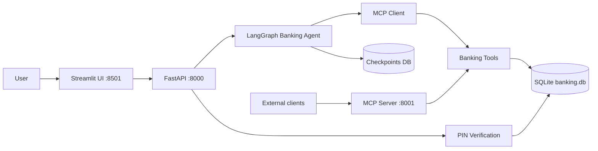
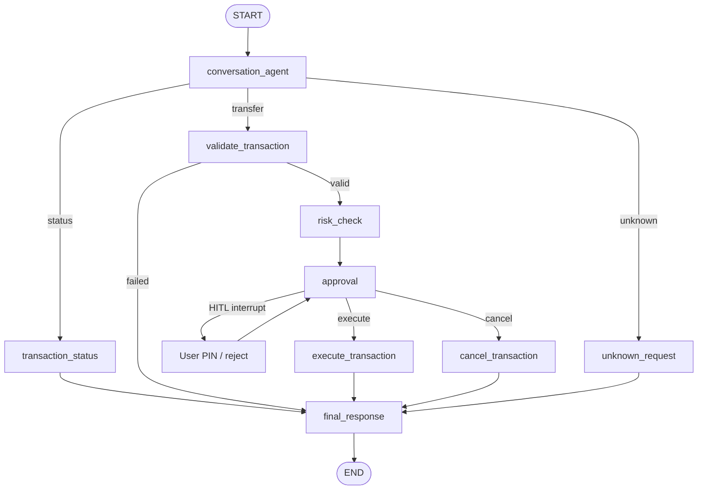

# Banking Agent

Agentic banking prototype built with **LangGraph**, **FastAPI**, **Streamlit**, and an **MCP** tool layer. The assistant can check transaction status, prepare transfers, pause for human-in-the-loop PIN approval, then execute or cancel the payment.

## Features

- Natural-language chat for **transaction status** and **bank transfers**
- LangGraph routing by intent: status, transfer, or unknown
- MCP tools for account validation, status lookup, and fund movement
- Risk scoring: `LOW` (≤ ₹10,000), `MEDIUM` (≤ ₹50,000), `HIGH` (> ₹50,000)
- Human-in-the-loop interrupt before money moves (PIN required)
- PIN verification with lockout after 3 failed attempts
- SQLite persistence for accounts, transactions, and graph checkpoints
- Streamlit chat UI with approve / reject controls
- FastAPI endpoints for chat, approve, reject, and thread state

## Architecture



### LangGraph topology



The `approval` node uses LangGraph `interrupt()`. FastAPI `/approve` and `/reject` resume the same thread with `Command(resume=...)`.

## Project layout

```text
src/
  backend/          FastAPI app, SQLite schema, PIN and transfer services
  graph/            LangGraph state, nodes, routers, compiled graph
  mcp/              MCP client adapter and HTTP MCP tool server
  ui/               Streamlit chat and HITL approval UI
  config.py         API_BASE_URL and MCP_BASE_URL
run.py              Start api, ui, mcp, or all three
```

## Setup

Python 3.11+ is required.

```bash
python3 -m venv .venv
source .venv/bin/activate
pip install -r requirements.txt
```

Or install the project (enables the `banking-api`, `banking-ui`, and `banking-mcp` commands):

```bash
pip install -e .
```

Copy environment defaults:

```bash
cp .env.example .env
```

## Run

Use one command per service, or start everything together.

| Service | URL | Command |
| --- | --- | --- |
| FastAPI | http://localhost:8000 | `python run.py api` |
| Streamlit UI | http://localhost:8501 | `python run.py ui` |
| MCP tools | http://localhost:8001 | `python run.py mcp` |
| All three | | `python run.py all` |

Equivalent Make targets:

```bash
make install
make api
make ui
make mcp
make run          # api + ui + mcp
```

After `pip install -e .`:

```bash
banking-api
banking-ui
banking-mcp
```

API docs: http://localhost:8000/docs  
MCP tools: http://localhost:8001/tools

Start **FastAPI first**, then the UI. The graph calls MCP tools in-process through `src/mcp/mcp_client.py`. The MCP server on port 8001 is the same tool surface for external clients.

## Demo data

Seeded on first API or MCP start:

| Field | Value |
| --- | --- |
| User | `USER001` / John Doe |
| PIN | `1234` |
| Source account | `ACC001` (₹100,000) |
| Destination account | `ACC002` (₹50,000) |
| Sample transaction | `TXN1001` — ₹5,000, `SUCCESS` |

A second user exists (`USER002`, PIN `5678`) but transfers in this prototype always debit `ACC001`.

## Feature examples

Open http://localhost:8501 after FastAPI is running, or call `/chat` with a stable `thread_id`.

### 1. Unknown request

```text
hello
```

Assistant explains it can check a transaction or make a transfer.

### 2. Transaction status

```text
What is the status of TXN1001?
```

Expected reply: transaction `TXN1001` for ₹5,000.00 is currently `SUCCESS`.

```bash
curl -s http://localhost:8000/chat \
  -H "Content-Type: application/json" \
  -d '{
    "thread_id": "demo-status",
    "user_id": "USER001",
    "message": "What is the status of TXN1001?"
  }'
```

### 3. Transfer with PIN approval

```text
Transfer 2500 to ACC002
```

The graph validates `ACC002`, scores risk as `LOW`, then pauses. The UI shows from/to accounts, amount, risk, and a PIN field.

Approve with PIN `1234`:

```bash
THREAD="demo-transfer"

curl -s http://localhost:8000/chat \
  -H "Content-Type: application/json" \
  -d "{
    \"thread_id\": \"$THREAD\",
    \"user_id\": \"USER001\",
    \"message\": \"Transfer 2500 to ACC002\"
  }"

# Use transaction_id from the previous response
curl -s http://localhost:8000/approve \
  -H "Content-Type: application/json" \
  -d "{
    \"thread_id\": \"$THREAD\",
    \"transaction_id\": \"PENDING_XXXXXXXX\",
    \"pin\": \"1234\"
  }"
```

### 4. Reject a pending transfer

```text
Send 15000 to ACC002
```

Risk is `MEDIUM`. Click **Reject Transaction**, or:

```bash
curl -s http://localhost:8000/reject \
  -H "Content-Type: application/json" \
  -d '{
    "thread_id": "demo-reject",
    "transaction_id": "PENDING_XXXXXXXX"
  }'
```

No funds are moved.

### 5. High-risk transfer

```text
Pay 60000 to ACC002
```

Risk is `HIGH`. Approval still requires PIN `1234`.

### 6. Validation failures

```text
Transfer 0 to ACC002
Transfer 100 to ACC001
Transfer 100 to ACC999
```

These return amount, same-account, and unknown-account errors without an approval interrupt.

### 7. MCP tools

```bash
curl -s http://localhost:8001/tools

curl -s http://localhost:8001/tools/get_transaction_status \
  -H "Content-Type: application/json" \
  -d '{"transaction_id": "TXN1001"}'

curl -s http://localhost:8001/tools/validate_account \
  -H "Content-Type: application/json" \
  -d '{"account_id": "ACC002"}'
```

## API

| Method | Path | Purpose |
| --- | --- | --- |
| `GET` | `/health` | API liveness |
| `POST` | `/chat` | Send a user message into the graph |
| `POST` | `/approve` | Resume after PIN verification |
| `POST` | `/reject` | Cancel a pending transfer |
| `GET` | `/threads/{thread_id}` | Inspect interrupt / next nodes |

`POST /chat` body:

```json
{
  "thread_id": "demo-1",
  "user_id": "USER001",
  "message": "Transfer 2500 to ACC002"
}
```

Responses:

- `{"status": "completed", "message": "..."}` for status, validation errors, and finished work
- `{"status": "approval_required", "transaction": {...}}` when HITL is waiting

Keep the same `thread_id` across chat, approve, and reject so the checkpointed graph can resume.

## How a transfer flows

1. `conversation_agent` parses intent, destination `ACC…`, and amount.
2. `validate_transaction` checks amount, distinct accounts, and MCP account lookup.
3. `risk_check` assigns a risk level and a pending transaction id.
4. `approval` interrupts and waits for the UI / API.
5. FastAPI verifies the PIN against the hashed value in SQLite.
6. `execute_transaction` calls the MCP transfer tool, or `cancel_transaction` clears the pending payment.
7. `final_response` writes the assistant message back into graph state.
