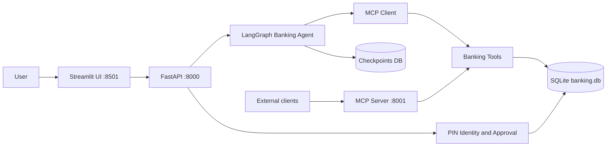
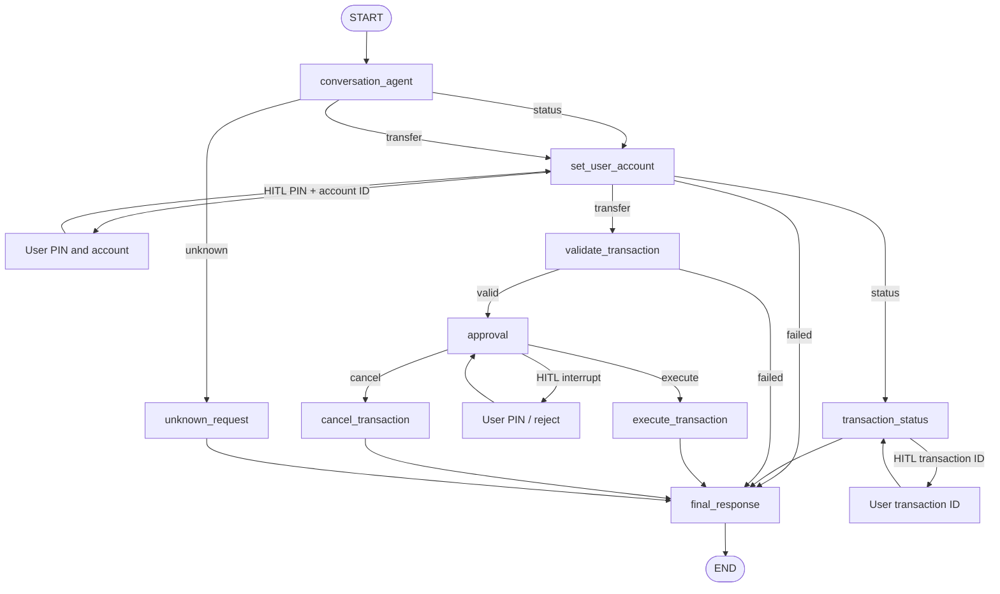

# Banking Agent

Agentic banking prototype built with **LangGraph**, **FastAPI**, **Streamlit**, and an **MCP** tool layer. The assistant can check transaction status, identify the sender from a PIN, prepare transfers, pause for human-in-the-loop approval, then execute or cancel the payment.

## Features

- Natural-language chat for **transaction status** and **bank transfers**
- LangGraph routing by intent: status, transfer, or unknown
- PIN identity: `set_user_account` looks up the user from PIN **and account ID**
- MCP tools for PIN account lookup, account validation, status lookup, and fund movement
- Human-in-the-loop interrupts for PIN identity, transfer status lookup, and transfer approval
- PIN verification with lockout after 3 failed approval attempts
- SQLite persistence for accounts, transactions, and graph checkpoints
- Streamlit chat UI with identify / approve / reject controls
- FastAPI endpoints for chat, identify, approve, reject, and thread state
- LangGraph Studio via `langgraph.json` (`banking_agent`)

## Architecture



### LangGraph topology



`set_user_account`, `transaction_status`, and `approval` use LangGraph `interrupt()`. FastAPI `/identify`, `/lookup`, `/approve`, and `/reject` resume the same thread with `Command(resume=...)`. In Studio, resume identity with `{"pin": "1234", "account_id": "ACC001"}` and status lookup with `{"transaction_id": "TXN1001"}`.

## Project layout

```text
src/
  backend/          FastAPI app, SQLite schema, PIN and transfer services
  graph/            LangGraph state, nodes, routers, compiled graph
  mcp/              MCP client adapter and HTTP MCP tool server
  ui/               Streamlit chat and HITL approval UI
  config.py         API_BASE_URL and MCP_BASE_URL
run.py              Start api, ui, mcp, or all three
Dockerfile          Image for api, ui, and mcp
docker-compose.yml  Run all three services with a shared SQLite volume
langgraph.json      LangGraph Studio / `langgraph dev` graph spec
```

## Setup

Python 3.11+ is required.

Do not zip and send `venv/`, `.db` files, or `.env`. Those are machine-local. Send source plus `requirements.txt`, then the recipient creates a new virtualenv.

```bash
python3 -m venv .venv
source .venv/bin/activate   # Windows: .venv\Scripts\activate
pip install -r requirements.txt
cp .env.example .env
python run.py api           # terminal 1 — http://localhost:8000
python run.py ui            # terminal 2 — http://localhost:8501
```

Or install the project (enables the `banking-api`, `banking-ui`, and `banking-mcp` commands):

```bash
pip install -e .
```

Copy environment defaults:

```bash
cp .env.example .env
```

## Run

Use one command per service, or start everything together.

| Service | URL | Command |
| --- | --- | --- |
| FastAPI | http://localhost:8000 | `python run.py api` |
| Streamlit UI | http://localhost:8501 | `python run.py ui` |
| MCP tools | http://localhost:8001 | `python run.py mcp` |
| All three | | `python run.py all` |

Equivalent Make targets:

```bash
make install
make api
make ui
make mcp
make run          # api + ui + mcp
make docker-up    # same three services in Docker
```

After `pip install -e .`:

```bash
banking-api
banking-ui
banking-mcp
```

API docs: http://localhost:8000/docs  
MCP tools: http://localhost:8001/tools

## Docker

Requires Docker Compose v2.

```bash
docker compose up --build
```

Or:

```bash
make docker-up
```

| Service | URL |
| --- | --- |
| Streamlit UI | http://localhost:8501 |
| FastAPI | http://localhost:8000 |
| MCP tools | http://localhost:8001 |

The UI container calls the API at `http://api:8000`. SQLite files (`banking.db` and graph checkpoints) live on the `banking-data` volume so API and MCP share the same accounts and transactions.

```bash
make docker-logs    # follow logs
make docker-down    # stop containers
docker compose down -v   # also delete the SQLite volume
```

Start **FastAPI first**, then the UI. The graph calls MCP tools in-process through `src/mcp/mcp_client.py`. The MCP server on port 8001 is the same tool surface for external clients.

LangGraph Studio (optional):

```bash
langgraph dev
```

Studio loads `./src/graph/app.py:graph`. The graph file puts `src/` on `sys.path` so the `graph` package imports under the src layout.

## Demo data

Seeded on first API or MCP start:

| User | Name | PIN | Source account | Balance |
| --- | --- | --- | --- | --- |
| `USER001` | John Doe | `1234` | `ACC001` | ₹100,000 |
| `USER002` | David | `5678` | `ACC002` | ₹50,000 |

Sample transaction: `TXN1001` — ₹5,000 from `ACC001` to `ACC002`, `SUCCESS`.

The source account is no longer hardcoded. `set_user_account` requires PIN **and** account ID (`1234` + `ACC001`, or `5678` + `ACC002`). The same thread reuses that identity on later transfers and status lookups until you start a new conversation.

## Feature examples

Open http://localhost:8501 after FastAPI is running, or call `/chat` with a stable `thread_id`.

### 1. Unknown request

```text
hello
```

Assistant explains it can check a transaction or make a transfer.

### 2. Transaction status

```text
What is the status of TXN1001?
```

The graph pauses for PIN identity (`status: pin_required`), then for the transaction ID (`status: txn_id_required`). PIN `1234` with account `ACC001` can look up `TXN1001`.

```bash
THREAD="demo-status"

curl -s http://localhost:8000/chat \
  -H "Content-Type: application/json" \
  -d '{
    "thread_id": "demo-status",
    "message": "What is the status of TXN1001?"
  }'

curl -s http://localhost:8000/identify \
  -H "Content-Type: application/json" \
  -d "{
    \"thread_id\": \"$THREAD\",
    \"pin\": \"1234\",
    \"account_id\": \"ACC001\"
  }"

curl -s http://localhost:8000/lookup \
  -H "Content-Type: application/json" \
  -d "{
    \"thread_id\": \"$THREAD\",
    \"transaction_id\": \"TXN1001\"
  }"
```

### 3. Transfer with PIN identity and approval

```text
Transfer 2500 to ACC002
```

The graph pauses for PIN identity (`status: pin_required`). PIN `1234` + account `ACC001` sets source `ACC001`; PIN `5678` + account `ACC002` sets source `ACC002`. After a valid identity it validates the destination, then pauses for approval. The UI shows from/to accounts, amount, and a PIN field.

You can also put the PIN and account in the chat message and skip the identity interrupt:

```text
Transfer 2500 to ACC002 pin 1234 from ACC001
```

```bash
THREAD="demo-transfer"

curl -s http://localhost:8000/chat \
  -H "Content-Type: application/json" \
  -d "{
    \"thread_id\": \"$THREAD\",
    \"message\": \"Transfer 2500 to ACC002\"
  }"

curl -s http://localhost:8000/identify \
  -H "Content-Type: application/json" \
  -d "{
    \"thread_id\": \"$THREAD\",
    \"pin\": \"1234\",
    \"account_id\": \"ACC001\"
  }"

# Use transaction_id from the identify / approval_required response
curl -s http://localhost:8000/approve \
  -H "Content-Type: application/json" \
  -d "{
    \"thread_id\": \"$THREAD\",
    \"transaction_id\": \"PENDING_XXXXXXXX\",
    \"pin\": \"1234\"
  }"
```

### 4. Transfer as the second user

```text
Transfer 1500 to ACC001 pin 5678 from ACC002
```

Identifies David, debits `ACC002`, and credits `ACC001`.

### 5. Reject a pending transfer

```text
Send 15000 to ACC002
```

Identify with PIN `1234`, then click **Reject Transaction**, or:

```bash
curl -s http://localhost:8000/reject \
  -H "Content-Type: application/json" \
  -d '{
    "thread_id": "demo-reject",
    "transaction_id": "PENDING_XXXXXXXX"
  }'
```

No funds are moved.

### 6. Validation failures

```text
Transfer 0 to ACC002 pin 1234 from ACC001
Transfer 100 to ACC001 pin 1234 from ACC001
Transfer 100 to ACC999 pin 1234 from ACC001
```

These return amount, same-account (USER001 sending to `ACC001`), and unknown-account errors without an approval interrupt. An invalid identity PIN (`0000`) or a PIN/account mismatch (`1234` + `ACC002`) ends the turn with an identification error.

### 7. MCP tools

```bash
curl -s http://localhost:8001/tools

curl -s http://localhost:8001/tools/get_transaction_status \
  -H "Content-Type: application/json" \
  -d '{"transaction_id": "TXN1001"}'

curl -s http://localhost:8001/tools/validate_account \
  -H "Content-Type: application/json" \
  -d '{"account_id": "ACC002"}'

curl -s http://localhost:8001/tools/get_account_by_pin \
  -H "Content-Type: application/json" \
  -d '{"pin": "1234", "account_id": "ACC001"}'
```

## API

| Method | Path | Purpose |
| --- | --- | --- |
| `GET` | `/health` | API liveness |
| `POST` | `/chat` | Send a user message into the graph |
| `POST` | `/identify` | Resume after PIN + account identity (`set_user_account`) |
| `POST` | `/lookup` | Resume after transaction ID (`transaction_status`) |
| `POST` | `/approve` | Resume after PIN verification |
| `POST` | `/reject` | Cancel a pending transfer |
| `GET` | `/threads/{thread_id}` | Inspect interrupt / next nodes |

`POST /chat` body:

```json
{
  "thread_id": "demo-1",
  "message": "Transfer 2500 to ACC002"
}
```

`user_id` is optional. The graph sets `user_id` and `source_account` from the PIN.

Responses:

- `{"status": "completed", "message": "..."}` for status, validation errors, identity failures, and finished work
- `{"status": "pin_required", "message": "..."}` when `set_user_account` is waiting for a PIN and account ID
- `{"status": "txn_id_required", "message": "..."}` when `transaction_status` is waiting for a transaction ID
- `{"status": "approval_required", "transaction": {...}}` when HITL approval is waiting

Keep the same `thread_id` across chat, identify, lookup, approve, and reject so the checkpointed graph can resume.

## How a transfer flows

1. `conversation_agent` parses intent, destination `ACC…`, amount, and optional `pin …` / `from ACC…` in the message.
2. `set_user_account` interrupts for a PIN **and account ID** (unless both were already in the message or this thread is already identified), then MCP `get_account_by_pin` sets `user_id` and `source_account`.
3. Status lookups then interrupt `transaction_status` for a transaction ID (`POST /lookup`). Transfers continue to validation.
4. `validate_transaction` checks amount, distinct accounts, and MCP account lookup, then writes `pending_transaction`.
5. `approval` interrupts and waits for the UI / API.
6. FastAPI `/approve` verifies the PIN against the hashed value in SQLite.
7. `execute_transaction` calls the MCP transfer tool, or `cancel_transaction` clears the pending payment.
8. `final_response` writes the assistant message back into graph state.
